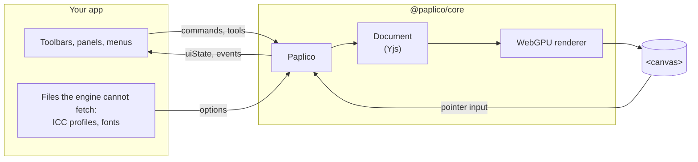

# Paplico Core

`@paplico/core` is the drawing engine behind the Paplico app, packaged for your own web app. You hand it a `<canvas>`. It takes care of pointer input, brushes, the document, WebGPU rendering, undo and collaboration. Your app draws everything around the canvas: toolbars, panels, menus.

The engine knows nothing about React or any other framework. It is plain TypeScript, and its state lives in [Valtio](https://valtio.dev) proxies that any UI layer can read.

## How it fits into your app



Everything your app touches hangs off one `Paplico` instance:

| Member | What you do with it |
| --- | --- |
| `paplico.tools` | Pick the current tool, brush, stroke and fill colors |
| `paplico.commands` | Change the document: add, update, group or delete elements, undo and redo |
| `paplico.selection` | Read and change which elements are selected |
| `paplico.uiState` | Read the document, the current layer, the selection and `canUndo` / `canRedo` |
| `paplico.fonts` | List the fonts your font loaders offer |
| `paplico.on(...)` | Hear about GPU device loss, collaboration state and the eyedropper |

Every document change goes through `commands`. That one path keeps undo, redo and remote edits consistent with each other.

## Reading state from your UI

`paplico.uiState` is a Valtio proxy. In React, take a snapshot of it and re-render when it changes:

```tsx
import type { Paplico } from "@paplico/core";
import { useSnapshot } from "valtio";

function UndoButton({ paplico }: { paplico: Paplico }) {
	const { canUndo } = useSnapshot(paplico.uiState);
	return (
		<button disabled={!canUndo} onClick={() => paplico.commands.undo()}>
			Undo
		</button>
	);
}
```

Outside React, `subscribe(paplico.uiState, callback)` from `valtio` does the same.

## Where to go next

- [Getting Started](/core/docs/getting-started) puts a working canvas on your page.
- [Bundler Setup](/core/docs/bundler-setup) covers the one alias your bundler needs.
- [Fonts](/core/docs/fonts), [Export](/core/docs/export) and [Collaboration](/core/docs/collaboration) go deeper into each area.
- [Entry Points](/core/docs/entry-points) lists what each import path contains.
